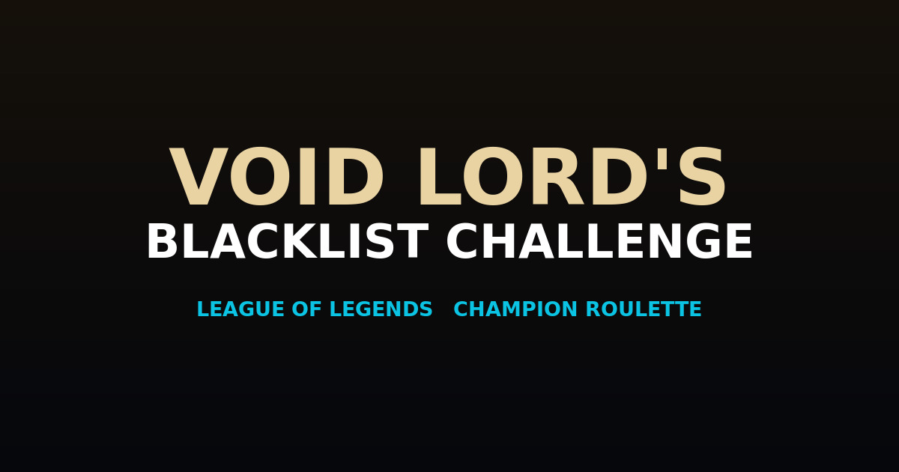

# Void Lord's Blacklist Challenge

Private project. A personal League of Legends champion roulette: spin the wheel, get a champion revealed in their rarest skin, then survive the run. Win to build your streak; lose and that champion is blacklisted for good.

## Features
- Spin-to-assign wheel of every current champion, on an HTML5 canvas with mastery rings.
- Rarest-skin reveal (Mythic, Legendary, Ultimate, Exalted, Transcendent) with HD splash art and animated splashes.
- Champion voice lines on reveal, English by default with an EN / TR toggle.
- Win streaks, the Zilean revival, an ever-growing blacklist, and a game-over summary.
- Optional Riot account (your own dev key) for mastery, match history, LP, and live-game detection.

## Legal
League of Legends and all related assets are property of Riot Games, Inc. This is an unofficial fan project, not affiliated with or endorsed by Riot Games.

---

(c) 2026 Hir. All rights reserved. Private repository: the source is not licensed for reuse, redistribution, or deployment by anyone else.
